 

 

## 👋 About Me

**Computer Science Student · Automation & Data Extraction**

I build **API-driven engines** that extract, enrich, and manage business data — and I automate the workflows around them. Alongside work, I'm building strong CS foundations through structured self-study.

- ⚙️ Building **data extraction engines** and **automation workflows** with Python and APIs
- 🎓 Following the **OSSU Computer Science** curriculum and **MIT 6.100L**
- 🛡️ Studying **Cybersecurity** in parallel
- 🌍 Working in **Arabic & English**

 

## 💼 Experience

<table>
<tr>
<td width="72" align="center" valign="middle">🏢</td>
<td valign="top">

**Automation & Data Extraction** · [PTP Technological Solutions](https://ptp.sa/)  
Saudi Arabia

- Build **API engines** that extract business data from external platforms
- Store, enrich, and **manage data** for prospecting and operations
- Automate repetitive **business workflows** to reduce manual work

</td>
</tr>
</table>

 

## 🚀 Featured Projects

<table>
<tr>
<td colspan="2" valign="top">

### 🔎 Apollo Supplier Research Engine
Python CLI that finds industrial spare-parts suppliers in Saudi Arabia through the official Apollo.io API, then stores, enriches, and exports the results.

- **Credit-aware search** — dry runs, credit caps, and resumable pagination
- **SQLite storage** with migrations and run logs
- **Enrichment** — company websites, people lookup, scope classification and prioritization
- **Export** to Excel and CSV, with offline unit tests

`Python` `REST API` `SQLite` `Data Enrichment` `CLI` `Testing`

[**Repository ↗**](https://github.com/qusaigubran/Apollo_api)

</td>
</tr>
<tr>
<td width="50%" valign="top">

### 🐍 Python Task API
Tested REST API for managing tasks — full CRUD, SQLite persistence, documented Swagger UI, CI on every push, and Docker support.

`Python` `FastAPI` `SQLite` `Pytest` `GitHub Actions` `Docker`

[**Repository ↗**](https://github.com/qusaigubran/python-task-api)

</td>
<td width="50%" valign="top">

### 🛍️ PEONISA
Premium bilingual Shopify storefront for an Arabic/English abaya brand — refined UX, reliable commerce flows, RTL, accessibility, and performance.

`Shopify Liquid` `Responsive UI` `RTL` `i18n`

[**Live site ↗**](https://peonisa.com/)

</td>
</tr>
<tr>
<td colspan="2" valign="top">

### 💻 Personal Portfolio
Personal frontend project focused on reusable UI components, responsive design, and a clean Git workflow.

`Frontend` `Responsive Design` `Git`

</td>
</tr>
</table>

 

## 🛠️ Tech Stack

<table>
<tr>
<td align="center" width="150"><b>Languages</b></td>
<td>

</td>
</tr>
<tr>
<td align="center" width="150"><b>Backend & Data</b></td>
<td>

</td>
</tr>
<tr>
<td align="center" width="150"><b>Data & Prospecting</b></td>
<td>

</td>
</tr>
<tr>
<td align="center" width="150"><b>Meta Platforms</b></td>
<td>

</td>
</tr>
<tr>
<td align="center" width="150"><b>Automation & Commerce</b></td>
<td>

</td>
</tr>
<tr>
<td align="center" width="150"><b>Frontend</b></td>
<td>

</td>
</tr>
<tr>
<td align="center" width="150"><b>Tools & DevOps</b></td>
<td>

</td>
</tr>
</table>

 

## 🏅 Certifications

<table>
<tr>
<td width="50%" valign="top">

**CS50's Introduction to Programming with Python**  
Harvard University · CS50P · Issued Jun 2026

`Python` `OOP` `Unit Testing` `pytest` `Regular Expressions` `File I/O`

[**View credential ↗**](https://certificates.cs50.io/da882037-2359-4827-85ff-7bb3cf4ea58a.pdf)

</td>
<td width="50%" valign="top">

**Programming for Everybody (Getting Started with Python)**  
University of Michigan · Coursera · Issued Oct 2026

`Python` `Programming Fundamentals` `Problem Solving`

[**View credential ↗**](https://www.coursera.org/account/accomplishments/records/LM5BX10I1H5Q)

</td>
</tr>
</table>

 

## 🧭 Learning Roadmap

| Track | Focus | Status |
| :--- | :--- | :---: |
| 🎓 **OSSU Computer Science** | Full self-taught CS curriculum — programming, math, systems, theory | 🟢 In progress |
| 🐍 **MIT 6.100L** | Introduction to CS and Programming using Python | 🟢 In progress |
| 🛡️ **Cybersecurity Specialization** | Google Cybersecurity Certificate · University of Helsinki Cyber Security MOOC | 🟢 In progress |
| 🧮 **Algorithms & Backend Systems** | Data structures, algorithms, APIs, databases | 🟢 Ongoing |

 

## 📊 GitHub Activity

 

  

